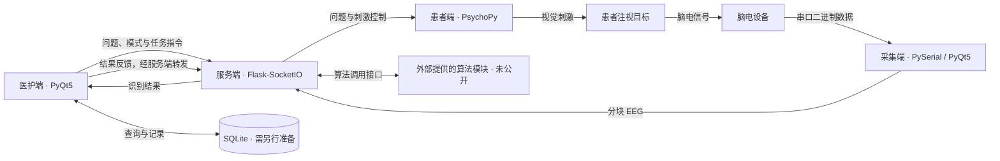

# 基于 SSVEP 脑机接口的 ICU 智能查房系统

**SSVEP-based ICU Intelligent Ward Round System**

本项目面向 ICU 沟通受限患者的选项式交流场景，将视觉刺激、脑电采集、意图识别和医护业务流程连接起来，支持患者需求表达、查房问答、量表记录与历史结果管理。

患者通过注视屏幕上不同频率的刺激目标表达选择，系统将识别结果映射为当前问题的答案或具体需求，并在医护端展示、记录和处理。系统由脑电采集端、患者交互端、医护端和算法服务端四个独立进程组成。


## 主要功能

| 模块 | 功能 |
|---|---|
| 医护工作站 | 患者信息管理、医生/护士模式切换、题库与问题分类维护、手动查房、自动查房、暂停与继续 |
| 患者交互 | SSVEP 多目标视觉刺激、问题与选项呈现、选择反馈、两级需求菜单、语音提示 |
| 脑电采集 | 串口设备接入、自定义二进制帧解析、通道选择、导联状态展示、波形和频谱显示、数据记录与分块上传 |
| 通信与任务 | 终端注册、定向消息路由、识别任务授权、数据序号检查、任务结果匹配、心跳与重连 |
| 算法接入 | 保留 FBCCA、EEGNet 及双算法模式的调用接口和业务流程，具体算法模块需另行提供 |
| 数据与报表 | 患者需求处理、查房答案保存、量表计分、历史查询、统计展示与 Excel 导出 |
| 认知激活 | 激活内容选择、播放控制、时长与结果记录；视频素材需另行准备 |
| 运行管理 | 图形化进程控制、进程启停、运行日志展示与启动脚本 |

量表相关界面覆盖焦虑、抑郁、睡眠、健康和认知问卷，具体题目、选项及分值依赖业务数据库中的配置。

## 系统架构



医护端负责业务操作，患者端负责刺激呈现，采集端负责设备数据接入，服务端负责消息协调与识别任务调度。各端通过 Socket.IO 事件通信，识别结果携带任务信息，便于与当前业务轮次对应。

本仓库的通信实现为 Python Socket.IO；患者刺激使用 PsychoPy，医护界面使用 PyQt5。

## 典型交互流程

1. 启动服务端和各终端，完成终端注册、患者选择与设备检查。
2. 医护端选择查房问题或需求菜单，设置识别模式并发起任务。
3. 患者端呈现与答案对应的刺激目标，患者注视希望选择的目标。
4. 采集端连续读取脑电，以小批次聚合并向服务端上传。
5. 服务端将数据交给外部算法模块，完成结果筛选、任务匹配和回传。
6. 医护端将目标类别映射为答案或需求，反馈给患者，并保存记录供查询和导出。

## 技术栈

| 方向 | 主要技术 |
|---|---|
| 语言与平台 | Python 3.10、Windows |
| 医护与采集界面 | PyQt5、Qt Designer、PyQtGraph、Matplotlib |
| 患者刺激呈现 | PsychoPy、NumPy |
| 网络通信 | Flask、Flask-SocketIO、python-socketio、eventlet |
| 设备接入 | PySerial、自定义串口二进制协议 |
| 并发协作 | 多进程、线程、互斥锁、条件变量、有界消息队列 |
| 数据与报表 | SQLite、Pandas、OpenPyXL |
| 语音与媒体 | Edge TTS、Pygame、OpenCV |

依赖版本见 [requirements-runtime.txt](requirements-runtime.txt)、[requirements-patient.txt](requirements-patient.txt) 和 [pyproject.toml](pyproject.toml)。依赖清单中保留了原系统的算法运行库需求，安装这些库不会补齐未公开的算法源码或模型。

## 目录结构

```text
.
├── main.py                         # 消息服务、会话管理与识别任务调度
├── run_1cs.py                      # 医护端主程序和业务逻辑
├── 智能查房患者端cs.py              # PsychoPy 患者刺激与交互程序
├── runtime_concurrency.py          # 有界队列及带序号的历史缓冲
├── wordTexts.py                    # 服务地址、刺激频率、布局与流程参数
├── start_controller.py             # 图形化进程管理器
├── start_all.ps1 / start_all.bat    # 启动进程管理器
├── start_all多窗口.ps1              # 多窗口启动入口
├── Screen_Click.py                 # 屏幕操作辅助
├── TTS.py                          # 语音合成与播放
├── *.ui / 界面对应的 *.py           # Qt Designer 界面与生成代码
├── SerialPort32/
│   ├── Afy_2cs.py                  # 当前采集端入口
│   ├── 放大器13.py / res.py        # 采集界面及编译资源
│   ├── Experimental_paradigm/      # 通道与范式配置
│   ├── imgs/                       # 采集界面图片
│   └── 其他采集脚本                 # 设备调试和历史版本
├── 多功能智能查房系统/
│   ├── yihu.qrc / yihu_rc.py       # 医护界面资源清单与编译资源
│   └── 图片与切图目录               # 界面图片素材
├── imgs/                           # 患者端背景与需求交互图片
├── 人体图/                         # 身体部位等交互素材
├── tests/
│   └── test_runtime_concurrency.py # 并发组件测试
└── requirements*.txt               # Python 依赖清单
```

## 环境准备

### 创建 Python 环境

在 Windows 上安装 Python 3.10 和 Git 后，使用 PowerShell 克隆项目并创建独立环境：

```powershell
git clone https://github.com/futurellx/SSVEP-based-ICU-Intelligent-Ward-Round-System.git
cd SSVEP-based-ICU-Intelligent-Ward-Round-System

py -3.10 -m venv .venv
.\.venv\Scripts\python.exe -m pip install -r requirements.txt
```

`requirements.txt` 引用基础运行依赖和患者端依赖。项目包含 Windows 接口、桌面图形及较早版本的 PsychoPy，安装需要匹配 Python 版本和本机图形、音频环境；依赖安装成功不代表设备和完整业务链路已就绪。

### 准备未公开的运行依赖

运行完整系统前，还需要自行提供以下内容：

| 内容 | 源码中的位置或用途 |
|---|---|
| FBCCA 算法模块 | `main.py` 引用 `FBCCA_Online.FBCCA` 和 `fbcca2.FBCCA2` |
| EEGNet 推理与训练模块 | `main.py` 引用 `train.test` 和 `train.train`；使用个体模型时还需对应权重和配置 |
| 业务数据库 | 项目根目录的 `hospital_rounds.db`，应包含与业务代码匹配的患者、题库、答案及需求等表 |
| 认知激活视频 | 使用视频激活功能时，需按患者端代码约定准备 `认知激活素材/` 下的文件 |
| 设备与显示环境 | 与采集协议匹配的脑电设备、串口驱动，以及正确配置的患者端显示器 |


### 检查连接与刺激配置

主要配置位于 [wordTexts.py](wordTexts.py)：

- `main_ip`：客户端连接的 Socket.IO 服务地址，当前默认 `http://127.0.0.1:9999`。
- `sample_rate`：当前脑电采样率配置为 250 Hz。
- `refresh_rate`：患者刺激使用的显示刷新率配置为 240 Hz，应与实际显示环境核对。
- `frequency_list2` 至 `frequency_list8`：不同目标数量对应的刺激频率。
- 目标布局、训练时序和默认判决参数等其他设置。

多机运行时，需要把客户端服务地址设置为服务端可访问的地址，并检查端口连通性。设备采集代码面向特定的32通道放大器，当前串口配置为921600 baud、105字节帧；连接其他设备前需核对并适配协议。

## 启动方式

以下完整启动流程以算法模块、数据库、依赖和设备环境均已准备好为前提。缺少算法模块时，直接运行 `main.py` 会因导入失败而退出。

### 图形化进程管理器

从项目根目录运行：

```powershell
.\.venv\Scripts\python.exe start_controller.py
```

在管理器中选择 Python 环境、检查各脚本路径，再启动服务端和客户端。管理器支持分别启动、停止和重启程序，并展示日志与进程状态。

也可以运行 `start_all.bat` 或 `start_all.ps1` 打开管理器；脚本优先使用项目内 `.venv`。需要多个独立控制台时，可使用 `start_all多窗口.ps1`。

### 分别启动各进程

在四个 PowerShell 窗口中，将工作目录均设为项目根目录，先启动服务端：

```powershell
# 窗口一：服务端，默认端口9999
.\.venv\Scripts\python.exe main.py
```

服务端就绪后，分别启动患者端、医护端和采集端：

```powershell
# 窗口二：患者端
.\.venv\Scripts\python.exe "智能查房患者端cs.py"
```

```powershell
# 窗口三：医护端
.\.venv\Scripts\python.exe run_1cs.py
```

```powershell
# 窗口四：采集端
.\.venv\Scripts\python.exe SerialPort32\Afy_2cs.py
```

启动程序后，还需在界面中完成设备连接、患者与题目选择、采集和上传等操作。患者端使用全屏呈现，应先确认显示器布局。

## 组件测试

公开代码中的并发组件测试可独立运行，不需要脑电设备或私有算法模块：

```powershell
.\.venv\Scripts\python.exe -m unittest discover -s tests -p test_runtime_concurrency.py -v
```

这组测试覆盖有界队列的拒绝与淘汰策略、关闭唤醒、历史缓冲独立读游标和条件通知。它验证的是组件行为，完整识别、显示时序、设备兼容和业务流程需在补齐运行依赖后另外验证。


